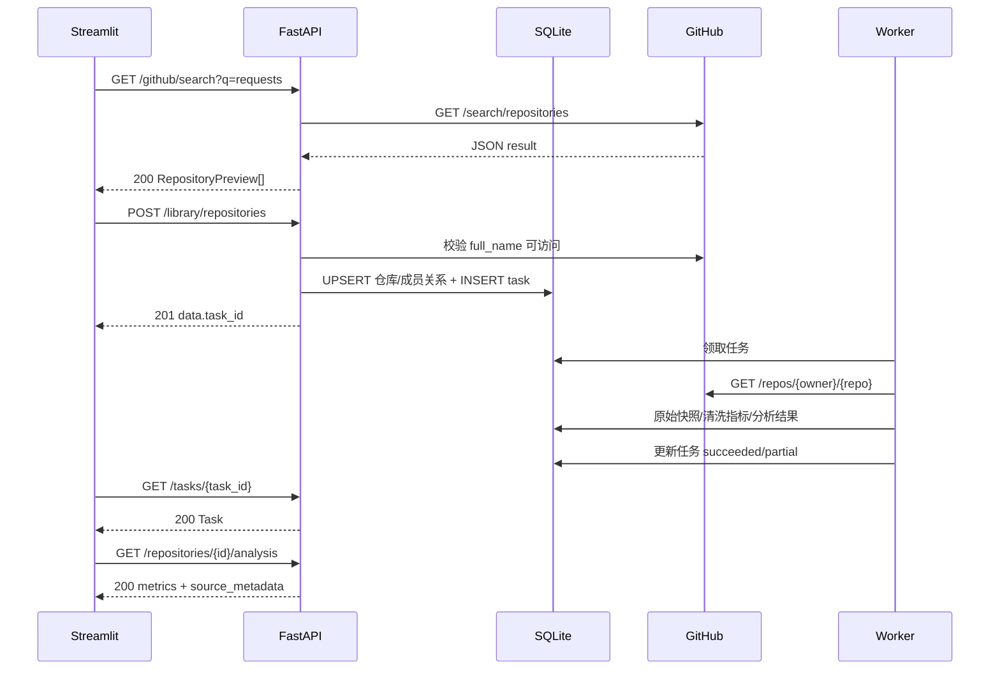

# GitHub 开源项目数据分析与技术选型辅助系统
# API 接口契约与联调规范（前后端共同遵循）v1.0

> 状态：**拟定并锁定的项目内部接口契约**，不是已经上线的接口。2026-10-13。
> 适用人群：Streamlit 前端开发者、FastAPI 后端开发者、测试者。
> 产品依据：《项目介绍》v1.0、《UI/UX 实施规范》v1.0 与《视觉主题修订》v2.0。
> 权威次序：**本契约 > 两端实施文档中的示例 > HTML 视觉原型**。任何破坏性修改必须前后端共同确认并更新文档和契约测试。

---

## 0. 架构与调用边界

```text
浏览器 ──HTTP──> Streamlit(8501) ──服务端 HTTP/JSON──> FastAPI(127.0.0.1:8000)
                         │                                    │
                         │                                    ├─ SQLite（持久化）
                         │                                    ├─ GitHub REST API（搜索/预览）
                         │                                    └─ 任务入队（SQLite）
                         │
                         └─ Plotly 图表（使用 API 结构化数据绘制）

后台 Worker（独立进程） ──取任务/更新状态──> SQLite
          └─ GitHub REST API ──> 原始记录校验与清洗 ──> SQLite/本地归档
```

- Streamlit 不直接访问 SQLite、GitHub，也不负责数据清洗/指标计算；它只消费本契约的后端 API。
- 前端不直接向浏览器暴露 GitHub Token 或内部 API Key。`API_BASE_URL=http://127.0.0.1:8000`；服务端请求携带 `X-Internal-Api-Key`。
- `GET /healthz` 不要求内部 Key；其他 `/api/v1/*` 都要求，除了 FastAPI 文档端点只允许本地访问。无账号体系：首版为**单一共享工作区**；公开部署必须加反向代理访问认证，不能把无用户隔离的分析库作为多人产品公开。
- 客户端和服务端都使用 UTF-8 / JSON；日期一律 UTC ISO 8601 `2026-10-13T10:30:00Z`。
- 实现用 FastAPI + Pydantic v2；运行后在 `/openapi.json` 暴露生成的正式 OpenAPI。**本文件描述预期行为，部署 OpenAPI 必须与之完全相符。**

## 1. 统一命名、状态和数据语义

| 名称 | 类型 | 契约含义 |
|---|---|---|
| `repository_id` | int64 | GitHub 原生仓库 ID；全局稳定主键。仓库重命名后 ID 不变 |
| `full_name` | string | `owner/repo`；用于显示和 GitHub API 查询，可能变动 |
| `dataset_id` | string | 如 `research-2026-v1` 或 `library-default`；`research-*` 固定研究样本，`library-default` 用户分析库 |
| `task_id` | UUID string | 一次或一次复用的后台采集/分析任务 |
| `scope` | enum | `research` / `library`；所有群体图表必须展示当前口径 |
| `depth` | enum | `basic` / `deep`；基础分析无需遍历完整历史事件 |
| `data_status` | enum | `missing` / `fresh` / `stale`，由成功采集时间与 TTL 推导，独立于任务状态 |
| `task.status` | enum | `queued` / `running` / `succeeded` / `partial` / `failed` / `cancelled` |
| `task.phase` | enum/null | `collecting` / `cleaning` / `analyzing` / `persisting`，仅执行中展示 |
| `analysis_status` | enum | `not_started` / `queued` / `processing` / `completed` / `partial` / `failed` |
| `coverage` | enum | `complete` / `partial` / `not_collected`；历史事件分页未取全不得假称完整 |

`null` 代表缺失/未知；数值 `0` 代表已核实为零。历史指标仅使用真实采集快照，不根据当前值回填过去。

## 2. HTTP 通用约定

### 2.1 请求

- 所有接口使用前缀 `/api/v1`；`Accept: application/json`。
- 内部调用请求头：`X-Internal-Api-Key: <由双方本地环境变量配置的秘密值>`。禁止将 Key 写进仓库、HTML 或页面日志。
- 创建任务接口建议包含 `Idempotency-Key`（UUID）；重复请求同一 key 返回原结果，不生成重复任务，存储 24h 后允许过期。
- 查询分页统一 `page` 从 1 开始、`per_page` 默认 20、最大 100；超范围返回 `422`。
- 排序/筛选采用显式白名单，不拼接任意 SQL/任意 GitHub 查询片段。

### 2.2 正常响应

所有 JSON API 成功响应格式：

```json
{
  "data": {},
  "meta": {
    "request_id": "req_01example",
    "generated_at": "2026-10-13T10:30:00Z"
  }
}
```

列表再加：`meta.pagination = {"page":1,"per_page":20,"total":126,"has_next":true}`。如 GitHub 搜索候选总量并非完整可遍历，额外返回 `meta.search = {"total_count":...,"incomplete_results":...,"result_window_limit":1000}`；不要把它混同本地库总量。

- `201 Created`：新建成员/资源；`200 OK`：读取、已有成员的幂等添加；`202 Accepted`：后台任务已创建或复用；`204 No Content`：删除分析库成员关系成功，不附响应体。
- 不对成功响应进行无意义二次包装；前端只读取 `data` 和 `meta`。

### 2.3 异常响应

```json
{
  "error": {
    "code": "GITHUB_RATE_LIMITED",
    "message": "GitHub 请求暂时受限，请稍后重试",
    "details": {"retry_after_seconds": 120}
  },
  "request_id": "req_01example"
}
```

| HTTP | 内部错误代码 | 场景/前端行为 |
|---|---|---|
| 400 | `INVALID_REPOSITORY_URL` | 仓库地址格式不正确；提示重新输入 |
| 401 | `UNAUTHORIZED_CLIENT` | 内部 Key 错误；停止请求并提示配置问题 |
| 404 | `REPOSITORY_NOT_FOUND` / `RESOURCE_NOT_FOUND` | GitHub 仓库不可见、已删除或本地实体不存在；不暴露私有仓库信息 |
| 409 | `CONFLICTING_OPERATION` | 任务执行中发生不允许的状态操作 |
| 422 | `VALIDATION_ERROR` | 参数范围、枚举、数量不合约定，`details.fields` 标注字段 |
| 429 | `GITHUB_RATE_LIMITED` | GitHub 已限流，显示重试时间/可用缓存 |
| 502 | `GITHUB_UPSTREAM_ERROR` | GitHub 非预期错误或无效载荷 |
| 503 | `BACKEND_UNAVAILABLE` / `WORKER_UNAVAILABLE` | 服务/Worker 不可用，保留既有数据 |
| 504 | `GITHUB_TIMEOUT` | 外部 GitHub 查询超时，允许重试 |

若 GitHub 返回私有/不存在的同一类 404，不区分给用户。所有服务端记录 `request_id`，日志不得包含 Token。

## 3. 共用数据对象定义

### 3.1 `RepositoryPreview`

```json
{
  "repository_id": 1362490,
  "full_name": "psf/requests",
  "html_url": "https://github.com/psf/requests",
  "description": "Python HTTP client",
  "language": "Python",
  "stars": 54599,
  "forks": 12662,
  "archived": false,
  "is_fork": false,
  "already_in_library": false,
  "github_updated_at": "2026-10-13T08:52:27Z"
}
```

以上数字仅作**响应格式示例**，不是产品运行时应显示的固定数字。`description`、`language`、`github_updated_at` 可以为 null。不要把仓库 `updated_at` 当作最近代码推送日期。

### 3.2 `RepositorySummary`（分析库/概览行）

```json
{
  "repository_id": 1362490,
  "full_name": "psf/requests",
  "description": "Python HTTP client",
  "language": "Python",
  "stars": 54599,
  "forks": 12662,
  "created_at": "2011-02-13T18:38:17Z",
  "pushed_at": "2026-09-28T16:55:48Z",
  "archived": false,
  "analysis_status": "completed",
  "data_status": "fresh",
  "last_successful_collection_at": "2026-10-13T10:30:00Z",
  "latest_task_id": null,
  "datasets": ["library-default"]
}
```

仓库基础指标缺失时为 null；`last_successful_collection_at` 未成功采集时为 null，不能伪装成现在时间。

### 3.3 `Task`

```json
{
  "task_id": "11111111-2222-4333-8444-555555555555",
  "repository_id": 1362490,
  "type": "collect_repository",
  "depth": "basic",
  "status": "running",
  "phase": "cleaning",
  "progress_percent": null,
  "message": "正在规范化仓库字段",
  "attempt": 1,
  "created_at": "2026-10-13T10:30:00Z",
  "started_at": "2026-10-13T10:30:03Z",
  "finished_at": null,
  "error": null
}
```

进度百分比无法可靠计算时必须为 null，前端用不定进度提示而非虚假百分比。

### 3.4 `SourceMetadata`（分析可信度元信息）

```json
{
  "source": "GitHub REST API",
  "collected_at": "2026-10-13T10:30:00Z",
  "window_start": "2026-07-15T00:00:00Z",
  "window_end": "2026-10-13T00:00:00Z",
  "sample_size": 400,
  "dataset_id": "research-2026-v1",
  "coverage": "complete",
  "notes": ["开源项目样本，不代表 GitHub 全体仓库"]
}
```

## 4. 接口目录（v1 必须实现）

| # | 方法 | Path | 作用 | 阶段 |
|---:|---|---|---|---|
| 1 | GET | `/healthz` | 健康探针 | P0 |
| 2 | GET | `/api/v1/system/status` | 服务、Worker、GitHub 配额快照 | P1 |
| 3 | GET | `/api/v1/github/search` | GitHub 远程仓库搜索 | P0 |
| 4 | POST | `/api/v1/github/resolve` | 粘贴 URL/owner/repo 查询仓库预览 | P0 |
| 5 | POST | `/api/v1/library/repositories` | 添加仓库并建立采集任务 | P0 |
| 6 | GET | `/api/v1/library/repositories` | 我的分析库列表 | P0 |
| 7 | DELETE | `/api/v1/library/repositories/{repository_id}` | 从分析库移除（非物理删库） | P1 |
| 8 | GET | `/api/v1/repositories/{repository_id}` | 仓库详情与最新指标 | P0 |
| 9 | POST | `/api/v1/repositories/{repository_id}/refresh` | 刷新/深度分析任务 | P1 |
| 10 | GET | `/api/v1/repositories/{repository_id}/analysis` | 单仓库分析 | P0 |
| 11 | GET | `/api/v1/repositories/{repository_id}/series` | 历史快照序列 | P1 |
| 12 | GET | `/api/v1/tasks` | 任务列表 | P0 |
| 13 | GET | `/api/v1/tasks/{task_id}` | 单任务状态轮询 | P0 |
| 14 | POST | `/api/v1/tasks/{task_id}/retry` | 失败/部分失败重试 | P1 |
| 15 | GET | `/api/v1/datasets` | 数据集（样本）版本列表 | P1 |
| 16 | GET | `/api/v1/overview` | 总览 KPI、语言分布等 | P0 |
| 17 | GET | `/api/v1/research/statistics` | 固定研究样本统计与相关性 | P1 |
| 18 | GET | `/api/v1/research/data-quality` | 数据质量报告 | P1 |
| 19 | POST | `/api/v1/comparisons` | 仓库比较（只读计算） | P1 |
| 20 | GET | `/api/v1/exports/repositories.csv` | CSV 导出 | P1 |

> P0 = 核心闭环，P1 = 课程完整演示；不设计永久删除研究数据、外部多用户登录、任意 SQL 查询接口。`/docs` 与 `/openapi.json` 是 FastAPI 自带，仅绑定本地环境。

## 5. 各接口详细契约

### API-01 `GET /healthz`

- 无 Token；200 响应：`{"status":"ok"}`。不进行昂贵外部 GitHub 调用；用于进程存活检查。DB/Worker 详细情况由 `/system/status` 反映。

### API-02 `GET /api/v1/system/status`

- 查询参数：无。
- `200 data`：

```json
{
  "api": "ok",
  "database": "ok",
  "worker": "ok",
  "worker_last_heartbeat_at": "2026-10-13T10:29:50Z",
  "github": {"rate_limit_remaining": 4120, "rate_limit_reset_at": "2026-10-13T11:00:00Z", "checked_at": "2026-10-13T10:28:00Z"},
  "queue": {"queued": 2, "running": 1, "failed": 0}
}
```

`worker` 值 `ok|stale|unknown`；GitHub 配额未知时对象字段为 null，不应每次查询都调用 GitHub。

### API-03 `GET /api/v1/github/search`

| Query | 类型 | 规则 |
|---|---|---|
| `q` | string | 必填，2–100 字符；后端安全构造 GitHub 搜索表达式 |
| `language` | string | 可选，允许常见语言标识或 `all` |
| `stars_min` | int | 可选，0–1000000 |
| `sort` | enum | `best_match`（默认）/`stars`/`updated` |
| `order` | enum | `desc`（默认）/`asc`；`best_match` 不传 upstream sort |
| `page` | int | 1–10，受 1000 条搜索窗口约束 |
| `per_page` | int | 1–100，默认 20；若 `(page-1)*per_page >= 1000` 则 422 |

- `200 data`: `{ "items": RepositoryPreview[] }`，`meta.search`: `total_count, incomplete_results, result_window_limit:1000`，`meta.pagination`: `page, per_page, has_next`（若超 1000 可观察窗口，has_next=false）。
- `429` 限流、`502` 其他 GitHub 错误、`504` 超时。输入搜索词必须做长度、控制字符、合法字符与频率校验，不接受前端提交任意完整 GitHub 查询语法。
- 搜索是远程只读，不自动保存全部搜索结果，不创建分析任务。

### API-04 `POST /api/v1/github/resolve`

请求：

```json
{"input":"https://github.com/psf/requests"}
```

也接受 `psf/requests`。只允许 `github.com` 仓库 URL（无嵌入凭据、无自定义端口、无 URL 查询）、符合 GitHub 仓库名称规则；不得向任意用户 URL 发网络请求（防 SSRF）。

- 200：`data` 为 `RepositoryPreview`。
- 400 `INVALID_REPOSITORY_URL`；404 `REPOSITORY_NOT_FOUND`；429/502/504 外部错误。

### API-05 `POST /api/v1/library/repositories`

请求：

```json
{"full_name":"psf/requests","auto_analyze":true,"depth":"basic"}
```

- `full_name` 必填；`auto_analyze` 默认 true；`depth` 默认 basic。
- 需校验仓库真实、公开；不得信任客户端传来的 Star、ID 等指标。
- 新增 201，已经是分析库成员则 200；`data` 为：

```json
{
  "repository_id": 1362490,
  "membership_created": true,
  "analysis_status": "queued",
  "task_id": "11111111-2222-4333-8444-555555555555"
}
```

- `auto_analyze:false` 时 `task_id:null`、`analysis_status:not_started` 或已有分析状态。
- 相同仓库重复添加只保留一条成员关系；执行中的同 `repo+depth` 任务复用现存 `task_id`，不产生重复采集；可选 `Idempotency-Key` 提升重试幂等性。
- 仓库在固定研究样本中的身份独立保留。

### API-06 `GET /api/v1/library/repositories`

| Query | 规则 |
|---|---|
| `q` | 本地关键字过滤；可空 |
| `language` | 可选 |
| `status` | `not_started|queued|processing|completed|partial|failed` 可选 |
| `sort` | `name|stars|last_collected`，默认 `name` |
| `order` | `asc|desc` |
| `page,per_page` | 通用分页 |

- 200：`data.items = RepositorySummary[]`、`meta.pagination`。列表 `stars/forks` 是最后成功采集的快照值。

### API-07 `DELETE /api/v1/library/repositories/{repository_id}`

- 成功 204；仅移除 `library-default` 成员关系，不删除仓库原始数据、研究样本、历史快照，也不取消运行中的任务。重复移除仍返回 204（幂等）；完全不存在的仓库返回 404。

### API-08 `GET /api/v1/repositories/{repository_id}`

- 200：`data.repository` 为 `RepositorySummary`，再加 `html_url, topics:string[], license_spdx:string|null, size_kb:int|null, open_issues_and_pr_count:int|null`、`source_metadata`。本接口只读数据库，不直连 GitHub；刚添加未采集时可返回 200 + 缺失字段、状态 queued。
- 404 本地无此仓库。

### API-09 `POST /api/v1/repositories/{repository_id}/refresh`

请求：`{"depth":"basic","force":false}`。

- 202：`data = {"task_id":"...","reused":false,"status":"queued"}`。
- 若已有运行中同级或更深任务且 `force:false`，`202 reused:true` 返回已有 task ID；不得并行创建两个同仓库的相同任务。
- `force:true` 仅表示忽略新鲜缓存、**不绕过**限流，也不与同仓库执行中的任务冲突；已有任务时仍复用。
- 404 仓库不存在。

### API-10 `GET /api/v1/repositories/{repository_id}/analysis`

`depth=basic|deep` 可选，默认 basic。

- 200 `data`：

```json
{
  "repository_id": 1362490,
  "depth": "basic",
  "analysis_status": "completed",
  "metrics": {
    "stars": 54599,
    "forks": 12662,
    "age_days": 5721,
    "days_since_push": 15.7,
    "release_count_365d": null,
    "commits_90d": null,
    "issues_closed_90d": null,
    "pr_merged_90d": null
  },
  "modules": {
    "profile": {"coverage":"complete"},
    "activity": {"coverage":"not_collected"},
    "community": {"coverage":"not_collected"}
  },
  "source_metadata": {"source":"GitHub REST API","collected_at":"2026-10-13T10:30:00Z","window_start":null,"window_end":null,"sample_size":1,"dataset_id":null,"coverage":"partial","notes":["深度活动指标未采集"]},
  "limitations": ["关注度指标不等于代码质量"]
}
```

- age_days、days_since_push 根据 UTC `collected_at` 与对应时间计算，不使用浏览器当前时间重算静态分析结果。
- 仅当前完成的模块可显示；深度数据缺失使用 null + `not_collected`，不能当 0。
- 没有可用分析结果时 `200` + `analysis_status:not_started|queued|processing`、`metrics:null`，前端引导等待，而不是 404。

### API-11 `GET /api/v1/repositories/{repository_id}/series`

`metric=stars|forks`（必填），`from` 和 `to` 为 `YYYY-MM-DD`（可选、含首尾），`granularity=day` 固定。

```json
{"data":{"repository_id":1362490,"metric":"stars","points":[{"date":"2026-10-12","value":54580},{"date":"2026-10-13","value":54599}],"observed_days":2,"note":"仅包含实际采集日期，没有补值"},"meta":{"request_id":"req_01example","generated_at":"2026-10-13T10:30:00Z"}}
```

同一天多次采集选最后一次成功快照；无记录 `points:[]`，绝不线性插值、凭空补历史值。

### API-12 `GET /api/v1/tasks`

- Query：`status` 可选（支持任务状态枚举），`repository_id` 可选，`page`/`per_page` 通用。
- 200 `data.items = Task[]`；按创建时间倒序，带 pagination。

### API-13 `GET /api/v1/tasks/{task_id}`

- 200 `data = Task`；404 不存在。建议前端 2–5s 轮询，完成后停止。

### API-14 `POST /api/v1/tasks/{task_id}/retry`

请求：`{}`；仅 `failed|partial` 的任务允许重试。

- 202 `data = {"task_id":"<新UUID>","retry_of":"<原UUID>","status":"queued"}`；返回**新**任务 ID，历史任务不可修改为 queued。
- 409 其他状态不可重试；重复点击的相同 `Idempotency-Key` 仍只创建一个新任务。

### API-15 `GET /api/v1/datasets`

- 200 `data.items=[{"dataset_id":"research-2026-v1","name":"开源软件研究样本 v1","type":"research","sample_size":400,"frozen_at":"2026-10-13T10:30:00Z","rules_version":"selection-v1"},{"dataset_id":"library-default","name":"我的分析库","type":"library","sample_size":23,"frozen_at":null,"rules_version":null}]`。
- 研究样本的 `sample_size` 指成员数，**不等于可用分析记录数**。

### API-16 `GET /api/v1/overview`

| Query | 规则 |
|---|---|
| `scope` | 必填 `research|library` |
| `dataset_id` | 当 scope=research 时必填，且必须为研究型数据集；library 时不传 |
| `language` | 可选二次过滤 |

响应 `data`：

```json
{
  "scope": "research",
  "dataset_id": "research-2026-v1",
  "kpis": {"repositories_total":400,"repositories_analyzed":365,"stars_median":830,"recently_pushed_90d_count":208},
  "language_distribution": [{"language":"Python","count":100},{"language":"Java","count":100},{"language":"Rust","count":100},{"language":"TypeScript","count":100}],
  "stars_distribution": [{"bucket":"0-999","count":120},{"bucket":"1000-9999","count":205},{"bucket":"10000+","count":75}],
  "source_metadata": {"source":"GitHub REST API","collected_at":"2026-10-13T10:30:00Z","window_start":null,"window_end":null,"sample_size":400,"dataset_id":"research-2026-v1","coverage":"partial","notes":["35 个样本尚无可用分析结果"]}
}
```

仅示例结构。`repositories_total` 为成员总数；统计中位数采用有效记录；统计图标注有效样本 `n`，禁用自动推断总体流行度的文案。

### API-17 `GET /api/v1/research/statistics`

- 必填 `dataset_id`（必须为 research）；可选 `language`；`group_by=language|star_tier|age_tier` 默认 language。
- `200 data`：

```json
{
  "dataset_id":"research-2026-v1",
  "group_by":"language",
  "valid_sample_size":365,
  "summary":{"stars":{"count":365,"mean":2470.2,"median":830,"std":5100.1},"forks":{"count":365,"mean":405.2,"median":97,"std":785.3}},
  "groups":[{"group":"Python","n":92,"stars_median":1150,"forks_median":110,"recently_pushed_90d_pct":62.0}],
  "correlations":[{"x":"stars","y":"forks","method":"spearman","n":365,"coefficient":0.73,"p_value":0.00001}],
  "source_metadata":{"source":"GitHub REST API","collected_at":"2026-10-13T10:30:00Z","window_start":null,"window_end":null,"sample_size":365,"dataset_id":"research-2026-v1","coverage":"partial","notes":[]}
}
```

数值为**格式示例**。单组不足以计算显著性时返回 `coefficient:null`、`p_value:null`，提供 `note`。相关性不代表因果。

### API-18 `GET /api/v1/research/data-quality`

- 必填 `dataset_id`（research）。
- `200 data={"dataset_id":"research-2026-v1","records_total":400,"records_analyzable":365,"missing_fields":[{"field":"pushed_at","count":3,"rate":0.0075}],"excluded_by_reason":[{"reason":"resource_collection","count":8}],"stale_count":22,"sampling_rules_version":"selection-v1","coverage_notes":["研究对象为筛选后的高关注度仓库，不代表全量 GitHub"]}`。
- 样本清洗排除理由必须可追溯，缺失率分母统一说明。

### API-19 `POST /api/v1/comparisons`

请求：

```json
{"repository_ids":[1362490,724712],"depth":"basic"}
```

- `repository_ids` 去重后 2～5 个；输入顺序是 UI 图例顺序；必须属于本地仓库集合且至少有基础有效数据；否则 `422 VALIDATION_ERROR` 或 `409 CONFLICTING_OPERATION`（解释缺少分析数据）。
- 200 `data`：

```json
{
  "repositories":[
    {"repository_id":1362490,"full_name":"psf/requests","metrics":{"stars":54599,"forks":12662,"days_since_push":15.7,"commits_90d":null},"coverage":"partial"},
    {"repository_id":724712,"full_name":"rust-lang/rust","metrics":{"stars":119774,"forks":18447,"days_since_push":0.3,"commits_90d":null},"coverage":"partial"}
  ],
  "comparison_basis":{"depth":"basic","metric_window":"latest_successful_snapshot","same_project_type":false,"warnings":["项目用途不同，不能直接判断谁更优秀"]}
}
```

指标不做任意加权“质量总分”；数据采样时间差超过 24h 显示对比警告。

### API-20 `GET /api/v1/exports/repositories.csv`

- Query：`scope` 必填；`dataset_id` 同 overview 规则。可选 `language`。
- 返回 200 `text/csv; charset=utf-8`，`Content-Disposition: attachment; filename="repositories_2026-10-13.csv"`；不是 JSON envelope。
- 列至少包含：`repository_id,full_name,language,stars,forks,created_at,pushed_at,collected_at,analysis_status,dataset_id`。CSV 单元格以 `= + - @` 开头时要防公式注入，确保 Excel 打开安全；不导出密钥和原始 Token。

## 6. 端到端时序与契约情形

### 6.1 搜索 → 添加 → 处理 → 展示



### 6.2 缓存、重复、失败

- 搜索 429：界面保留已有分析库数据，搜索区提示限流时间。
- 添加同一仓库两次：成员只有一条，同一执行中的任务复用。
- 刷新未变：记录 304 或“未更新”，不伪造 Star 增长记录。
- 任务失败：保留旧快照，可查看日志摘要、手动重试。
- 采集成功而深度分析部分失败：任务 `partial`，UI 展示基础结果与缺失模块。
- 单仓库删除分析库成员：不会删除研究样本或其他数据。

## 7. 锁定字段与契约变更协议

1. 前端以 `frontend/api/client.py` 单一客户端实现 HTTP，Pydantic/TypedDict 解析数据；**不能直接 import 后端 services/ORM**。
2. 后端为所有 JSON 路由设置 `response_model`，导出 `/openapi.json`；为错误包裹定义统一异常处理器。不得自行改字段名、时间语义和状态枚举。
3. 两端共同提供 `tests/contracts/fixtures/` 的 JSON fixture：`search_ok.json`、`add_created.json`、`task_running.json`、`analysis_missing.json`、`analysis_done.json`、`overview_research.json`、`github_limited.json`、`comparison_partial.json`。
4. 前端 Mock 必须只从 fixture 回放；不得在最终演示使用伪造真实数据。
5. 兼容变更（只加可选字段）可在同版本评审；破坏性变更需要版本提升、迁移说明与前端同步 PR。
6. 联调时先检查 `/healthz` 和 `/openapi.json`，再检查“搜索-添加-任务-详情-比较-研究统计-导出”闭环。

## 8. 验收接口案例（双方必须通过）

| Case | 测试步骤 | 期望 |
|---|---|---|
| C-01 | 搜索 `requests` | 200，结果数组含必须字段、分页与来源 |
| C-02 | 直接 resolve `psf/requests` | 200，返回稳定仓库 ID |
| C-03 | 添加公开仓库 | 201，成员关系创建、返回 task_id |
| C-04 | 重复添加 | 200，库里仍只有一条成员记录 |
| C-05 | 轮询任务 | 仅合法状态流转，成功后分析可读 |
| C-06 | 刷新已有仓库 | 202；无并行同仓库重复任务 |
| C-07 | 查询未采集历史 | 200，空 points，没有推测值 |
| C-08 | 比较两仓库 | 200，指标同名，同一缺失语义 |
| C-09 | 固定研究样本 | 用户添加仓库前后 research 总数不变 |
| C-10 | API 限流/超时 | 429/504，统一 error、保留缓存 |
| C-11 | 删除自选成员 | 204，研究数据不受影响 |
| C-12 | CSV 导出 | 可解析 UTF-8，列名与权限约束正确 |
| C-13 | 无效参数 | 422 错误包裹统一，前端能显示错误字段 |
| C-14 | Token 缺失 | 401 或启动配置错误，不泄露凭据 |

## 9. 官方参考链接

- GitHub REST API: https://docs.github.com/en/rest
- 仓库搜索: https://docs.github.com/en/rest/search/search#search-repositories
- 仓库详情: https://docs.github.com/en/rest/repos/repos#get-a-repository
- 速率限制: https://docs.github.com/en/rest/using-the-rest-api/rate-limits-for-the-rest-api
- 条件请求与最佳实践: https://docs.github.com/en/rest/using-the-rest-api/best-practices-for-using-the-rest-api
- FastAPI response_model: https://fastapi.tiangolo.com/tutorial/response-model/
- FastAPI APIRouter: https://fastapi.tiangolo.com/tutorial/bigger-applications/

**文档结束。此文件为内部拟定契约：先由两位开发者签收并固定，再进行并行开发。**
